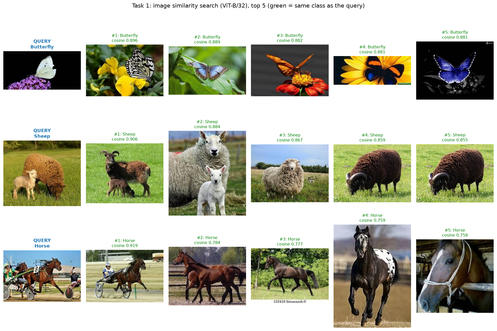
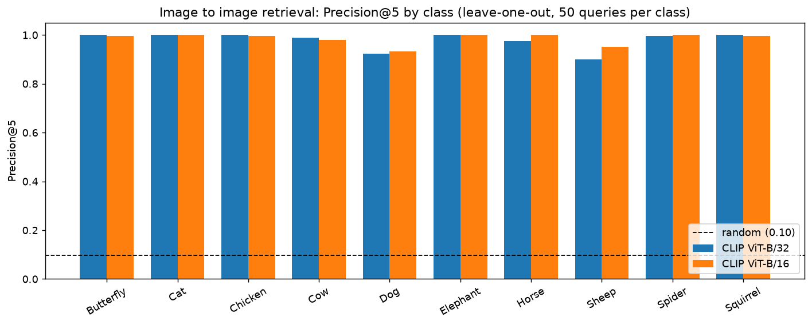
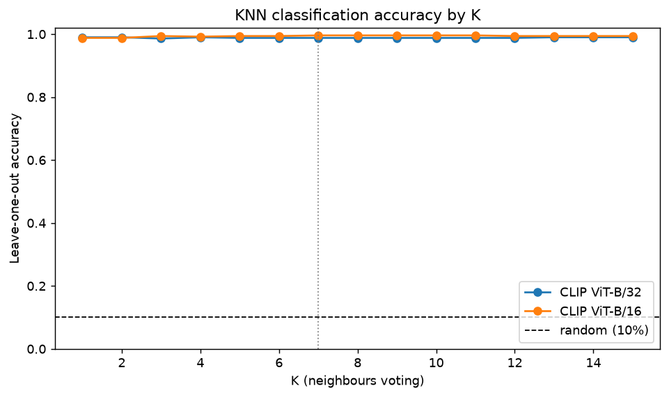
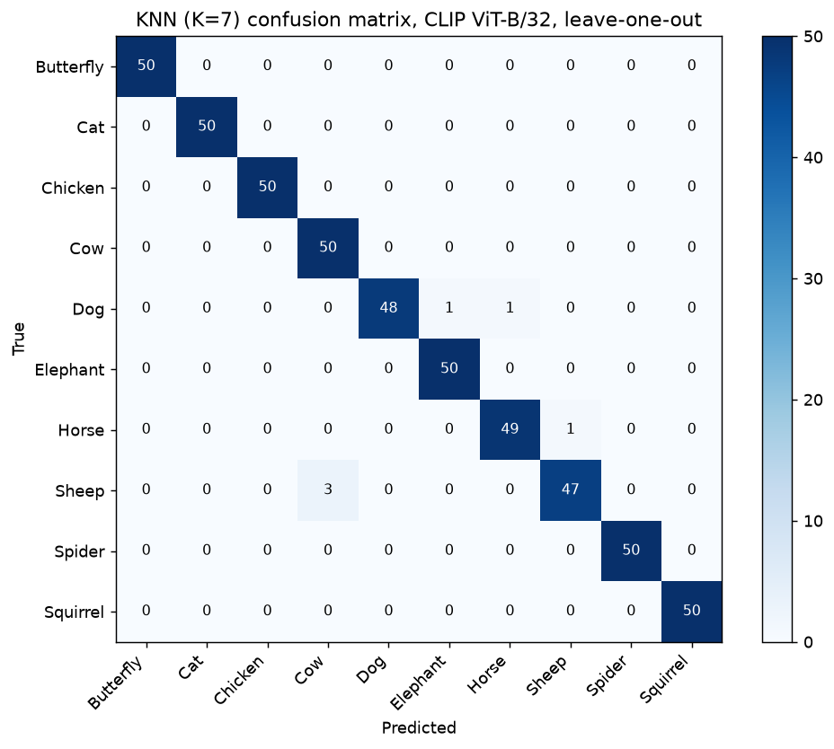
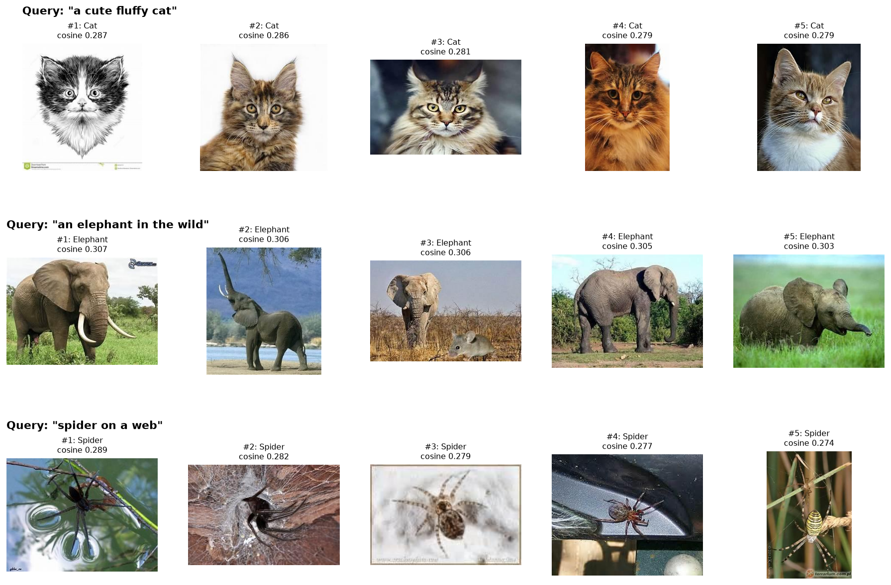
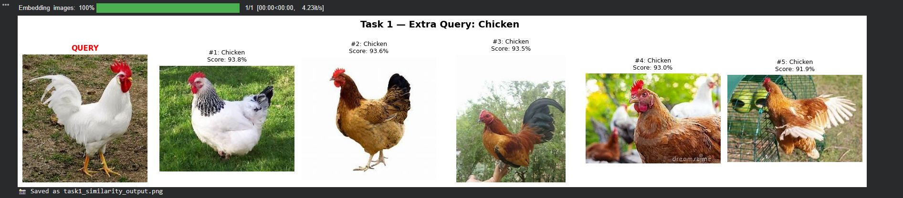
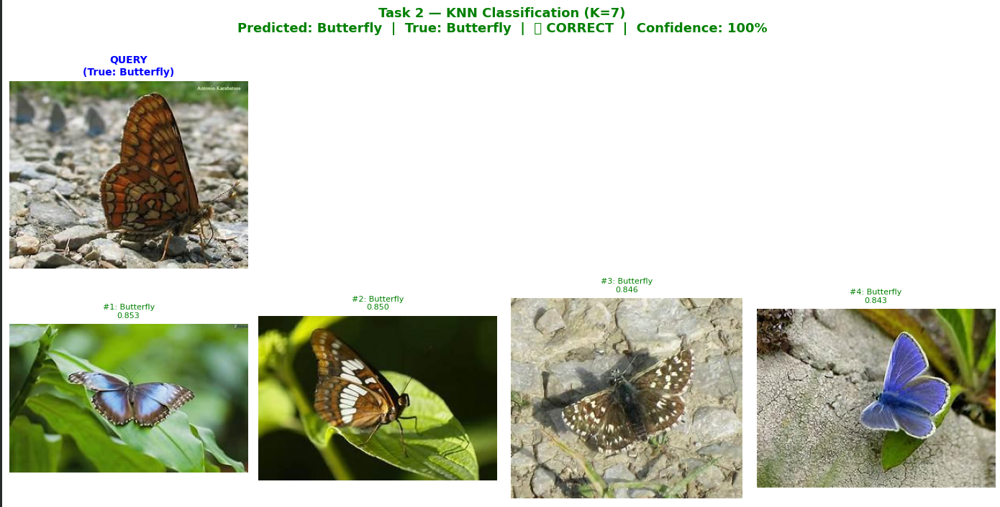
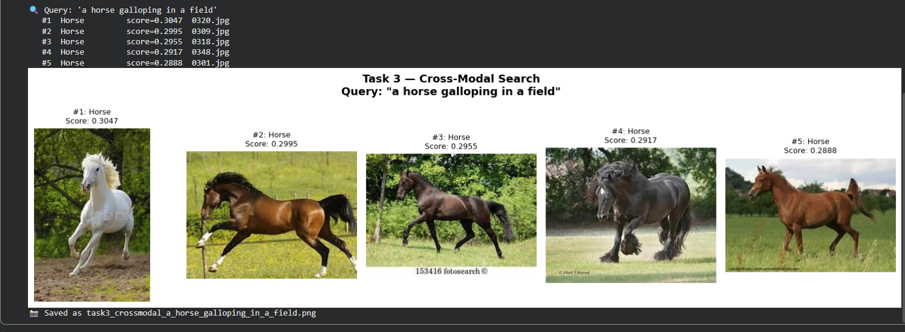

# VectorView: searching animal photos with CLIP embeddings


> **Headline:** on 500 animal photos, CLIP embeddings plus nearest-neighbour search classify **98.8% of images correctly (494 of 500) with no trained classifier**, and plain text prompts alone reach **99.0%**. Image-to-image retrieval returns a same-class image in the top 5 at a precision of 0.978 (random ranking: 0.096).

## Problem statement

Keyword search cannot find things that merely *look* alike, and labelling every new image by hand does not scale. A team with a photo catalogue (a shop, a media archive, a wildlife survey) wants to:

1. **find images similar to a given image**,
2. **label a new image from the labels of its nearest neighbours**, without training a model, and
3. **find images by typing a sentence**.

CLIP embeds images and text into one shared vector space, so all three become the same operation: nearest-neighbour search by cosine similarity. This project builds the three searches and, more importantly, **measures** how well they work, because "it looks right on a few examples" is not evidence.

It started as Lab 14 of the Database Lab (Spring 2026), which defined the three tasks around a vector database. This repository adds the evaluation: ranking metrics, a confusion matrix, zero-shot classification, and a comparison of two CLIP models.

## Data

| Property | Detail |
|---|---|
| Dataset | The Animal Image Dataset used in the lab: `data/animal_dataset.zip` |
| Size | 500 images, RGB, 120x80 to 300x300 pixels |
| Classes | 10, with 50 images each: Butterfly, Cat, Chicken, Cow, Dog, Elephant, Horse, Sheep, Spider, Squirrel |
| Quality checks | No duplicate files and no byte-identical images (checked in the notebook) |
| Source and licence | **Not recorded in this repo.** The images are web photos and some carry third-party watermarks, so treat the dataset as coursework material |

## Methodology

```text
 image  --CLIP image encoder-->  512-d vector --\
                                                 +--> cosine similarity --> top-K neighbours
 text   --CLIP text encoder--->  512-d vector --/                              |
                                                          Task 1: show the neighbours
                                                          Task 2: majority vote of their labels
                                                          Task 3: text query -> nearest images
```

1. **Embed** all 500 images with CLIP ([`openai/clip-vit-base-patch32`](https://huggingface.co/openai/clip-vit-base-patch32), 512 dimensions) and L2-normalise them, so a dot product is the cosine similarity. The same is repeated with [`clip-vit-base-patch16`](https://huggingface.co/openai/clip-vit-base-patch16) for a model comparison.
2. **Search** with exact cosine similarity over the 500 vectors, held in memory. A query image never retrieves itself.
3. **Evaluate every image as a query** (leave-one-out). An image is *relevant* to a query if it has the same class (49 relevant images per query). Metrics: Precision@k, Recall@k, MRR and nDCG@k, against a random-ranking baseline.
4. **KNN classification:** the K nearest neighbours vote; ties go to the nearest neighbour. Accuracy for K = 1 to 15, a confusion matrix, per-class precision and recall, and a Wilson 95% confidence interval.
5. **Text to image:** one prompt per class ("a photo of a cat"), scored as retrieval (Precision@k, mAP, MRR) and as **zero-shot classification** (label each image with the closest prompt, using no labelled images at all).

**About the vector databases.** The lab used Pinecone for Tasks 1 and 2 and suggested MongoDB Atlas Vector Search for Task 3. The Atlas free tier was not available to the original run, so Task 3 ran as in-memory search. The published notebook uses exact in-memory search for everything, so it runs with no accounts, and includes **optional** Pinecone and Atlas sections that switch on only when you set `PINECONE_API_KEY` / `MONGODB_URI`. Those two sections were **not executed** for the results below; the original-run screenshots further down come from the Colab run against Pinecone.

## Results

All numbers are printed by the executed cells of [`notebooks/VectorView.ipynb`](notebooks/VectorView.ipynb).

### Task 1: image similarity (leave-one-out over 500 queries)

| Model | P@1 | P@5 | P@10 | MRR | nDCG@10 |
|---|---|---|---|---|---|
| Random ranking | 0.097 | 0.096 | 0.098 | 0.251 | 0.097 |
| **CLIP ViT-B/32** | 0.990 | 0.978 | 0.971 | 0.993 | 0.974 |
| CLIP ViT-B/16 | 0.988 | 0.985 | 0.978 | 0.992 | 0.981 |

(Recall@10 can be at most 10/49 = 0.204 here, because each query has 49 relevant images and only 10 slots: ViT-B/32 reaches 0.198, random ranking 0.020.)





The hardest classes for ViT-B/32 are Sheep (P@5 0.900) and Dog (0.924); Butterfly, Cat, Chicken, Elephant and Squirrel are 1.000.

### Task 2: KNN classification (K = 7, leave-one-out)

| Model | Accuracy | 95% CI |
|---|---|---|
| Random guessing | 10.0% | |
| **CLIP ViT-B/32** | **98.8%** (494 / 500) | 97.4% to 99.4% |
| CLIP ViT-B/16 | 99.6% (498 / 500) | 98.6% to 99.9% |





Accuracy hardly depends on K (ViT-B/32 for K = 1, 3, 5, 7, 9 and 15: 0.986 to 0.990). The six ViT-B/32 mistakes are Sheep predicted as Cow (3), Dog as Elephant (1), Dog as Horse (1) and Horse as Sheep (1).

### Task 3: text to image

With one prompt per class, retrieval is near-perfect and the same prompts classify the images without any labels:

| Model | P@5 | P@10 | P@50 | MRR | mAP | Zero-shot accuracy |
|---|---|---|---|---|---|---|
| CLIP ViT-B/32 | 1.000 | 1.000 | 0.938 | 1.000 | 0.979 | 99.0% (495 / 500) |
| CLIP ViT-B/16 | 1.000 | 1.000 | 0.958 | 1.000 | 0.987 | 100% (500 / 500) |



A deliberately vague query behaves differently: "an animal" returns a top 20 spread over six of the ten classes (Elephant 6, Chicken 4, Cow 3, Horse 3, Squirrel 3, Spider 1).

<details>
<summary>Screenshots from the original Colab run (Pinecone for Tasks 1 and 2)</summary>

These are screenshots, not reproducible outputs.







More are in [`docs/images/original-run/`](docs/images/original-run/).

</details>

## Key insights

- **For this dataset the embeddings do almost all the work.** A 512-number vector from a model that never saw these labels is enough for 98.8% classification with a plain majority vote. No classifier is trained.
- **Labels are not even needed.** Zero-shot classification from ten text prompts (99.0%) matches KNN, which uses the labels of the other 499 images (98.8%).
- **Errors are plausible.** The mistakes concentrate on Sheep versus Cow and a few Dog images, animals that really do look alike in many photos.
- **The bigger model is not clearly better here.** ViT-B/16 is ahead on most aggregates, but its KNN lead is 4 images out of 500 and the confidence intervals overlap. The dataset is too easy to separate the two models.
- **At 500 vectors, a vector database is not the bottleneck.** Exact brute-force search takes about 0.1 ms per query. Approximate-nearest-neighbour indexes such as Pinecone's or Atlas's matter at far larger sizes; that was not measured here.
- **Vague text gives scattered results.** Specific prompts work; "an animal" does not pick out any class.

## Limitations and future improvements

- **Easy, small, clean data.** 500 classic animal photos, 10 well-separated classes: scores are close to the ceiling, so they say little about harder problems (fine-grained breeds, noisy photos).
- **Class-level relevance.** "Relevant" means same class, not "looks most alike", so the retrieval metrics do not capture subtler similarity.
- **Possible overlap with CLIP's training data.** CLIP was trained on web-scale image-text pairs and these are web photos, so the scores may flatter the model.
- **Pinecone and Atlas not measured.** The optional sections exist but were not run, so nothing here compares those services with exact search.
- **Only two models, one embedding per image.** No fine-tuning and no trained baseline.
- **Next steps:** run the optional sections with accounts and compare ANN against exact search (recall and latency); try a harder dataset and instance-level retrieval; add a baseline CNN or a linear classifier on the same embeddings to compare with KNN.

## Installation and how to run

Tested with **Python 3.15** on Windows 11, CPU only. From a fresh clone: `pip install` took 28 minutes on my connection (PyTorch and its dependencies are large downloads, and that run included retried dropped connections, so expect it to vary), and the notebook then ran in about 7 minutes, mostly embedding 500 images with two CLIP models on a CPU. The first run also downloads the two models (roughly 600 MB each) into the Hugging Face cache. Later runs reuse the embeddings cached in `data/cache/` and finish much faster.

```bash
git clone https://github.com/abdullahwaheed0112/VectorView.git
cd VectorView
python -m venv .venv
# Windows: .venv\Scripts\activate      macOS/Linux: source .venv/bin/activate
pip install -r requirements.txt
pip install jupyterlab
cd notebooks
jupyter lab VectorView.ipynb
```

Run from inside `notebooks/` (paths are relative). The dataset zip is extracted to `data/animal_dataset/` on first run. The notebook already contains its saved outputs, so it reads on GitHub without running.

**Optional vector databases.** `pip install -r requirements-optional.txt`, then set the environment variables before starting Jupyter. Never put keys in the notebook.

```bash
# Windows PowerShell: $env:PINECONE_API_KEY = "..."   macOS/Linux: export PINECONE_API_KEY=...
PINECONE_API_KEY   # section 7: Pinecone version of Tasks 1 and 2
MONGODB_URI        # section 8: MongoDB Atlas $vectorSearch version of Task 3 (needs a vector search index, see the notebook)
```

## Project structure

```text
VectorView/
├── data/
│   └── animal_dataset.zip              # 500 images, 10 classes (extracted to data/animal_dataset/ at run time)
├── docs/
│   └── images/                         # figures generated by the notebook
│       └── original-run/               # screenshots of the original Colab run
├── notebooks/
│   └── VectorView.ipynb                # the whole project, with saved outputs
├── requirements.txt                    # tested versions
├── requirements-optional.txt           # Pinecone and MongoDB clients (optional sections)
└── README.md
```

## Tech stack

Python · PyTorch · Hugging Face Transformers (CLIP) · NumPy · scikit-learn · matplotlib · Pillow · Jupyter. Optional: Pinecone, MongoDB Atlas Vector Search.

## My role, license and contact

- **Author:** Abdullah Waheed, BS Data Science student at FAST NUCES, Islamabad. Started as Lab 14 of the Database Lab (Spring 2026), which defined the three tasks; this repository adds the measured evaluation.
- **Dataset:** the lab's Animal Image Dataset; source and licence not recorded (see Data).
- **Code licence:** none chosen yet.
- **Contact:** [GitHub](https://github.com/abdullahwaheed0112) · [LinkedIn](https://linkedin.com/in/abdullah-waheed-05a5a1416)
